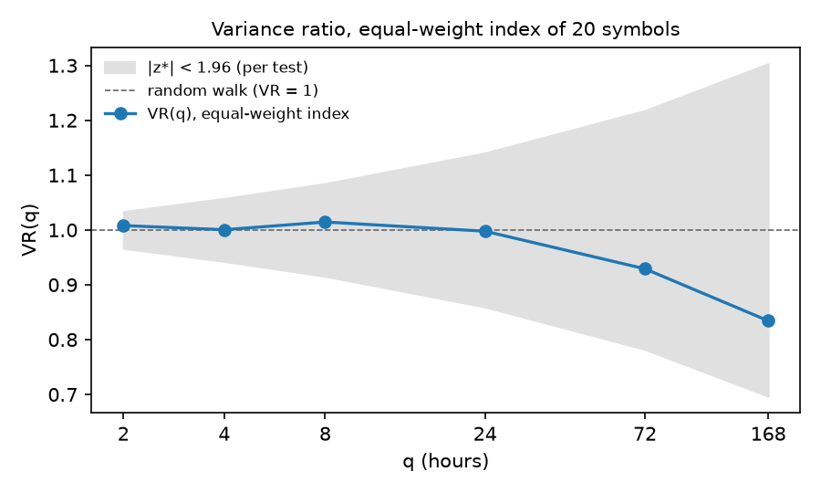

## What I found
Overall, I think hourly crypto returns don't show significant momentum or reversal at any of these horizons. None of the 126 tests is rejected after Holm, on the full panel or in either half. There is some overall reversal at longer horizons (the index VR is 0.93 at 72 hours and 0.83 at 168 hours), but it isn't significant, it is weaker in the second half, and at 168 hours there are only 88 non-overlapping weeks to work with. The decomposition shows where that reversal comes from. At 72 and 168 hours the own part is positive, so coins do reverse their own moves, but the cross part almost cancels it (+4.1 against −3.2 bp at 72 hours). This suggests the reversal is mostly market-wide, which a market-neutral strategy can't take advantage of. In the audit, the Sharpe before fees is about 0, so fees decide the loss at every deadband. The REJECT is explained by the decomposition rather than a bug, as the causality and null checks pass. A natural next step is to remove the common market move first (regressing each coin on the index) and build the contrarian on what is left.

Analysis code (not for merge): `research/arhaan/` in my fork at commit `<COMMIT_SHA>` (<link>).

## Declaration
_Posted <date, time UTC>. Two runs happened before posting (listed at the end of this section)._

- **$q$ list:** $q \in \{2, 4, 8, 24, 72, 168\}$ hours.
- **Series:** the 20 symbols and an equal-weight index, $r^{\text{EW}}_t = \frac{1}{20}\sum_{i} r_{i,t}$. Returns are hourly close-to-close log returns $r_{i,t} = \ln(C_{i,t}/C_{i,t-1})$ from `data/train_1h.parquet`; complete hourly grid, checked in code.
- **Primary test:** Lo–MacKinlay (1988) variance ratio from overlapping $q$-hour sums with their bias corrections, and the heteroskedasticity-robust statistic
  $$\mathrm{VR}(q) = \frac{\bar\sigma^2_c(q)}{\bar\sigma^2_a}, \qquad z^*(q) = \frac{\sqrt{nq}\,\bigl(\mathrm{VR}(q) - 1\bigr)}{\sqrt{\hat\theta(q)}}, \qquad \hat\theta(q) = \sum_{j=1}^{q-1}\Bigl[\tfrac{2(q-j)}{q}\Bigr]^2 \hat\delta(j),$$
  two-sided $p = 2\,\bigl(1 - \Phi(|z^*|)\bigr)$, Holm over all 126 tests at 5 % family-wise.
- **Split:** first and second half by timestamp midpoint (7,435 h each), same 126 tests with Holm within each half. Only full-panel Holm rejections are judged; a judged effect must keep the sign of $\mathrm{VR} - 1$ in both halves.
- **Decomposition:** Lo–MacKinlay (1990), for $q \in \{24, 72, 168\}$ on non-overlapping $q$-hour returns $R_t$, with $G_{ij} = \operatorname{cov}(R_{t-1,i}, R_{t,j})$, $N = 20$ and weights $w_{t,i} = -\bigl(R_{t-1,i} - \bar R_{t-1}\bigr)/N$:
  $$\text{own} = -\frac{N-1}{N^2}\operatorname{tr}G, \qquad \text{cross} = \frac{\mathbf{1}^\top G\,\mathbf{1} - \operatorname{tr}G}{N^2}, \qquad \text{mean} = -\operatorname{Var}_i(\hat\mu_i),$$
  checked against the average profit $\overline{\sum_i w_{t,i} R_{t,i}}$ of the same weights.
- **Bootstrap:** moving-block bootstrap over consecutive window pairs $(R_{t-1}, R_t)$; block length $b = \lceil T^{1/3}\rceil$ ($b = 9, 6, 5$ at $q = 24, 72, 168$, where $T$ = number of pairs); 2,000 replications; 95 % percentile intervals; fixed seed.
- **Strategy:** signal $-\ln(C_{i,t}/C_{i,t-Q})$, with the lookback matched on timestamp ($Q$ hours back, not $Q$ rows), then `cross_sectional_zscore` and `rebalance_deadband`; a missing close gives zero weight.
- **Horizon:** $Q = 72$ hours.
- **Deadband values audited:** $0,\ 0.015,\ 0.03$ (three trials, all reported).
- **Runs before posting:** VR tests on the full panel and halves on 17 Nov 17:40 UTC (0 of 126 rejected); decomposition on 20 Nov. $Q$ and the deadband values were chosen after seeing both.

## VR table (full panel)
Each cell: $\mathrm{VR}(q)$ with $z^*$ in brackets. **R** = rejected after Holm. Holm rejections: **0 of 126** on the full panel, 0 in the first half, 0 in the second half; no full-panel rejection, so nothing is judged in the split-half check.

| symbol | $q=2$ | $q=4$ | $q=8$ | $q=24$ | $q=72$ | $q=168$ |
|---|---:|---:|---:|---:|---:|---:|
| AAVEUSDT | 1.006 (+0.47) | 0.999 (-0.04) | 1.009 (+0.26) | 0.989 (-0.17) | 0.918 (-0.79) | 0.851 (-1.00) |
| ADAUSDT | 1.028 (+0.70) | 1.023 (+0.36) | 1.038 (+0.47) | 1.005 (+0.05) | 0.918 (-0.53) | 0.822 (-0.89) |
| APTUSDT | 0.994 (-0.44) | 0.999 (-0.05) | 0.994 (-0.15) | 0.953 (-0.72) | 0.910 (-0.88) | 0.830 (-1.17) |
| ARBUSDT | 1.025 (+1.40) | 1.036 (+1.15) | 1.069 (+1.51) | 1.085 (+1.16) | 1.050 (+0.45) | 1.015 (+0.10) |
| ATOMUSDT | 1.004 (+0.22) | 0.993 (-0.21) | 0.993 (-0.15) | 0.963 (-0.49) | 0.879 (-1.06) | 0.768 (-1.49) |
| AVAXUSDT | 1.010 (+0.64) | 1.007 (+0.27) | 1.011 (+0.27) | 0.992 (-0.11) | 0.915 (-0.80) | 0.806 (-1.30) |
| BNBUSDT | 1.003 (+0.16) | 0.982 (-0.63) | 0.977 (-0.53) | 0.982 (-0.25) | 0.924 (-0.64) | 0.892 (-0.64) |
| BTCUSDT | 0.992 (-0.55) | 0.981 (-0.72) | 0.979 (-0.52) | 0.953 (-0.70) | 0.904 (-0.88) | 0.898 (-0.65) |
| DOGEUSDT | 0.996 (-0.27) | 0.978 (-0.77) | 0.998 (-0.05) | 0.988 (-0.17) | 0.944 (-0.51) | 0.850 (-0.97) |
| DOTUSDT | 1.008 (+0.43) | 1.001 (+0.05) | 1.013 (+0.29) | 0.965 (-0.47) | 0.913 (-0.77) | 0.804 (-1.28) |
| ETHUSDT | 1.017 (+1.27) | 1.024 (+1.00) | 1.054 (+1.51) | 1.059 (+0.94) | 1.057 (+0.56) | 1.053 (+0.36) |
| INJUSDT | 0.992 (-0.37) | 0.973 (-0.79) | 0.980 (-0.43) | 0.964 (-0.51) | 0.926 (-0.70) | 0.785 (-1.45) |
| LINKUSDT | 0.998 (-0.16) | 0.988 (-0.45) | 0.985 (-0.38) | 0.971 (-0.42) | 0.863 (-1.24) | 0.803 (-1.26) |
| LTCUSDT | 0.989 (-0.64) | 0.972 (-0.93) | 0.962 (-0.87) | 0.939 (-0.82) | 0.826 (-1.45) | 0.685 (-1.87) |
| NEARUSDT | 0.994 (-0.44) | 0.981 (-0.73) | 0.994 (-0.16) | 1.015 (+0.23) | 1.039 (+0.37) | 0.921 (-0.52) |
| OPUSDT | 1.024 (+1.18) | 1.014 (+0.41) | 1.019 (+0.40) | 1.023 (+0.32) | 1.014 (+0.13) | 0.941 (-0.39) |
| SOLUSDT | 0.982 (-1.07) | 0.974 (-0.90) | 0.991 (-0.22) | 0.988 (-0.18) | 0.924 (-0.66) | 0.899 (-0.62) |
| SUIUSDT | 0.995 (-0.33) | 0.987 (-0.53) | 0.998 (-0.06) | 0.996 (-0.06) | 0.937 (-0.59) | 0.860 (-0.93) |
| UNIUSDT | 1.010 (+0.54) | 1.024 (+0.77) | 1.039 (+0.85) | 0.984 (-0.22) | 0.939 (-0.55) | 0.876 (-0.82) |
| XRPUSDT | 0.997 (-0.13) | 0.973 (-0.68) | 0.976 (-0.41) | 0.967 (-0.36) | 0.886 (-0.83) | 0.863 (-0.74) |
| **index** | 1.008 (+0.47) | 1.000 (+0.02) | 1.014 (+0.34) | 0.998 (-0.03) | 0.929 (-0.64) | 0.834 (-1.07) |



Grey band: $1 \pm 1.96\sqrt{\hat\theta(q)/nq}$, i.e. $|z^*| < 1.96$ for that test alone; Holm over 126 tests is stricter. $q = 168$ rests on 88 non-overlapping weeks, so it is weak evidence either way.

## Decomposition

| $q$ | windows | own | cross | mean | own + cross + mean | average profit | gap |
|---:|---:|---:|---:|---:|---:|---:|---:|
| 24 | 619 | -0.18 <sub>[-1.26, +1.19]</sub> | +0.19 <sub>[-1.06, +1.19]</sub> | -0.02 <sub>[-0.04, -0.01]</sub> | -0.00 | -0.00 <sub>[-0.22, +0.22]</sub> | +0.000 |
| 72 | 206 | +4.06 <sub>[-0.42, +9.71]</sub> | -3.18 <sub>[-8.19, +1.02]</sub> | -0.14 <sub>[-0.40, -0.10]</sub> | +0.75 | +0.75 <sub>[-0.21, +1.98]</sub> | +0.006 |
| 168 | 88 | +9.60 <sub>[-4.85, +26.45]</sub> | -8.79 <sub>[-24.20, +5.78]</sub> | -0.77 <sub>[-2.00, -0.49]</sub> | +0.04 | +0.02 <sub>[-2.22, +2.67]</sub> | -0.017 |

Basis points of log return per q-hour window. Brackets: 95 % moving-block bootstrap intervals over window pairs (2000 replications; block length $\lceil T^{1/3}\rceil$ = 9, 6, 5 at $q$ = 24, 72, 168). Gap = average profit $-$ (own + cross + mean), from estimating the means on $R_{t-1}$ vs $R_t$.

## Audit
All three trials REJECT; causality, null and lag checks pass in each. Reported setting: DEADBAND = 0.03.

| deadband | turnover / h | Sharpe at 0 bps [95 % CI] | Sharpe at 5 bps [95 % CI] | net PnL @ 5 bps | verdict |
|---:|---:|---|---|---:|:---:|
| 0 | 0.174 | +0.03 [−1.43, +1.49] | −3.09 [−4.54, −1.71] | −128.3 % | REJECT |
| 0.015 | 0.117 | −0.09 [−1.55, +1.32] | −2.19 [−3.61, −0.84] | −90.1 % | REJECT |
| 0.03 | 0.083 | −0.17 [−1.66, +1.29] | −1.66 [−3.09, −0.25] | −68.6 % | REJECT |

Full outputs: `out/audit/audit_Q72_deadband_0.txt`, `_0.015.txt`, `_0.03.txt`.

<details><summary>Audit output, DEADBAND = 0.03</summary>

```
========================================================================
SYNDICATE AUDIT REPORT :: arhaan_contrarian.py   (Q = 72, DEADBAND = 0.03)
========================================================================
    audit v1.3.2 | commit b5215be | strategy sha256 f32fe3ba05319efd
    data sha256 d68e6159bbdfb2e3
    causality seed 1934053172 | random cuts 8 (reproduce with --seed 1934053172)
    strategy process: host process
[1] DATA QUALITY     : DQS=99.93/100 (READY) | rows=297420 | symbols=20 | gaps=0 | funding_irreg=0
[2] CAUSALITY CHECK  : [PASS] Causal invariance verified across 14 prefix cuts (max diff=0.00e+00, seed=1934053172)
[3] RANK IC (1h fwd) : mean=+0.01305 | IC_IR=+0.044 | t=+5.33 (p=0.0000)
[4] RUNTIME          : 286.5 ms (1,038,252 rows/sec)
------------------------------------------------------------------------
[5] TRANSACTION COST DECAY MATRIX (1-bar lag + funding included):
    Fee (bps)      Sharpe     95% CI (block bootstrap)  DSR(N=10)   Ann.Ret     MaxDD  Turnover
       0.0 bps      -0.17  [-1.66, +1.29] (includes 0)      0.047    -4.23%   -64.48%    0.0825
       3.0 bps      -1.06  [-2.50, +0.36] (includes 0)      0.002   -25.92%   -82.36%    0.0825
       5.0 bps      -1.66               [-3.09, -0.25]      0.000   -40.38%   -94.29%    0.0825
      10.0 bps      -3.13               [-4.57, -1.75]      0.000   -76.53%  -135.24%    0.0825
    tiered ~7.7     -2.49               [-3.95, -1.10]      0.000   -60.80%  -112.04%    0.0825
    tiered = BTC/ETH 5 bps, 6 least liquid by trailing 30d volume 10 bps, others 7 bps
------------------------------------------------------------------------
[6] PURGED SPLIT (70% In-Sample / 24h Embargo / 30% Out-of-Sample @ 5.0 bps):
    In-Sample     : Sharpe=-0.25 [-2.04, +1.56] (includes 0) | DSR=0.068 | Ann.Ret=-5.85% | MaxDD=-35.75%
    Out-of-Sample : Sharpe=-4.64 [-7.21, -2.06] | DSR=0.000 | Ann.Ret=-123.79% | MaxDD=-68.02%
------------------------------------------------------------------------
[7] LAG SENSITIVITY TEST (+1 extra bar execution lag @ 5.0 bps):
    1-bar lag SR  : -1.66 | 2-bar lag SR: -1.60 | Retention: 0.0% [PASS]
[8] NULL PIPELINE CHECK (200 daily-block permutations of returns):
    Null SR mean  : -0.34 (sd 0.72, hurdle |mean| < 0.75) [PASS]
    Gross SR vs null: p=0.4428 (in-sample, informational only)
[9] FRICTION DRAG BREAKDOWN (@ 5.0 bps taker fee):
    Gross PnL     : -10.15%
    Fee Cost      : +61.37%
    Funding Drag  : -2.96%
    Net PnL       : -68.55%
[10] WICK & MARK INTEGRITY (liquidation wick / bad mark hurdle <= 20.0%):
    Wick PnL Share: 2.8% (3223 anomaly bars) [PASS - structural flow]
------------------------------------------------------------------------
[11] EXECUTION REALISM & MODEL BOUNDARIES:
    Fills         : signal on the close of bar t, filled at that close; lag-2 test = one hour of real delay
    Costs         : flat taker fee grid + tiered row, snapshot funding on the position held across settlement
    Scope Caveat  : Excludes orderbook queueing, depth-scaled impact (Almgren-Chriss), & adverse selection
[12] CORRELATION    : hourly net returns vs baseline_flow.py @ 5 bps = -0.38
[13] REVIEW FLAGS   : none (manual review, not part of the verdict)
========================================================================
FINAL VERDICT: [REJECT] FAILED AUDIT
========================================================================
```
</details>

## Local Verification Checklist
- [x] `python -m pytest -v` passes locally with zero failures.
- [x] Ran `python -m src.audit strategies/arhaan_contrarian.py` and pasted the output above (REJECT, explained by the decomposition).
- [x] The strategy reads only the `df` it is given; no file, network or environment access; no imports of `src.audit`, `src.backtest` or `src.sandbox`.
- [x] Zero procedural row-loops (`iterrows` / `itertuples`).
- [x] MIT License.
